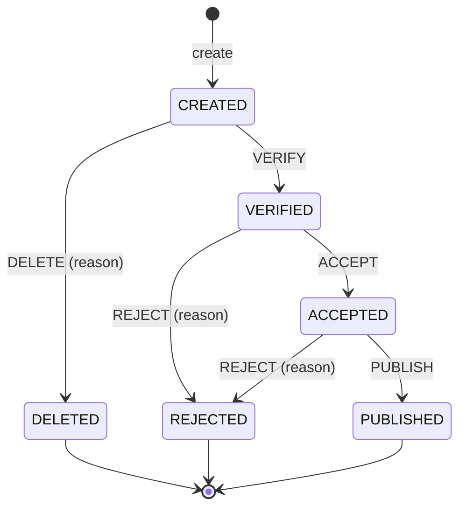

# Request Management

A backend service that manages the lifecycle of requests. Every request moves through a fixed set of states,
and each change of state must be allowed by the state diagram below. The service exposes a REST API,
stores requests in PostgreSQL and keeps an audit log of every state change.

Design decisions and assumptions for everything the specification leaves open are described in
[ASSUMPTIONS.md](ASSUMPTIONS.md).

## State diagram



- `name` and `body` are required when a request is created.
- `body` can be edited only in `CREATED` and `VERIFIED`.
- `DELETE` and `REJECT` require a reason.
- `PUBLISH` assigns a unique numeric publication number.
- `PUBLISHED`, `REJECTED` and `DELETED` are terminal: no further action is allowed.

## Tech stack

- Java 25, Spring Boot 4 (Web MVC, Data JPA, Validation, Actuator)
- PostgreSQL 17, Flyway migrations
- springdoc-openapi (Swagger UI)
- JUnit 5, AssertJ, Mockito, Testcontainers
- Lombok
- Checkstyle (layer boundaries and import hygiene)

## Running locally

Requirements: JDK 25 and Docker.

```bash
./gradlew bootRun
```

Spring Boot's Docker Compose support starts PostgreSQL from `compose.yaml` automatically,
and Flyway creates the schema on startup. The application listens on `http://localhost:8080`.

| URL | Description |
|---|---|
| http://localhost:8080/swagger-ui.html | Swagger UI, interactive API documentation |
| http://localhost:8080/v3/api-docs | OpenAPI specification (JSON) |
| http://localhost:8080/actuator/health | Health check |

To use an already running PostgreSQL instead, disable Compose support and point the datasource at it
with environment variables (see [Configuration](#configuration)):

```bash
SPRING_DOCKER_COMPOSE_ENABLED=false \
DB_URL=jdbc:postgresql://host:5432/requests DB_USERNAME=user DB_PASSWORD=secret \
./gradlew bootRun
```

## API

The full API documentation is generated from the code with springdoc-openapi. With the application running,
open **Swagger UI at http://localhost:8080/swagger-ui.html** to browse every endpoint, its parameters,
request and response models, and to call it directly from the browser.
The OpenAPI specification is available at http://localhost:8080/v3/api-docs (e.g. for import into Postman).

Base path: `/api/requests`

| Method | Path | Description |
|---|---|---|
| `POST` | `/api/requests` | Create a request (`201 Created` with a `Location` header) |
| `GET` | `/api/requests` | List requests: paging and optional filters |
| `GET` | `/api/requests/{id}` | Get one request, including its body |
| `PATCH` | `/api/requests/{id}` | Edit the body |
| `POST` | `/api/requests/{id}/transitions` | Perform an action from the state diagram |
| `GET` | `/api/requests/{id}/history` | Audit log of state changes |

### Examples

Create a request:

```bash
curl -i -X POST localhost:8080/api/requests \
  -H 'Content-Type: application/json' \
  -d '{"name": "Holiday", "body": "Two weeks in August"}'
```

Change its state (`action` is one of `VERIFY`, `ACCEPT`, `REJECT`, `DELETE`, `PUBLISH`):

```bash
curl -X POST localhost:8080/api/requests/{id}/transitions \
  -H 'Content-Type: application/json' \
  -d '{"action": "VERIFY"}'

curl -X POST localhost:8080/api/requests/{id}/transitions \
  -H 'Content-Type: application/json' \
  -d '{"action": "REJECT", "reason": "Budget exceeded"}'
```

Browse (all parameters are optional):

```bash
curl 'localhost:8080/api/requests?name=holi&state=VERIFIED&page=0&size=10'
```

### Errors

Errors are returned as [RFC 9457](https://www.rfc-editor.org/rfc/rfc9457) problem details:

| Status | When |
|---|---|
| `400 Bad Request` | Missing, invalid or too long field, missing reason, malformed JSON, invalid paging parameter |
| `404 Not Found` | Request does not exist |
| `409 Conflict` | Action not allowed in the current state, body edit not allowed, concurrent modification |
| `500 Internal Server Error` | Unexpected error; the response does not expose internal details |

```json
{
  "title": "Invalid state transition",
  "status": 409,
  "detail": "Action PUBLISH is not allowed in state CREATED",
  "currentState": "CREATED",
  "action": "PUBLISH"
}
```

Validation errors list every invalid field:

```json
{
  "status": 400,
  "detail": "Validation failed",
  "errors": [
    { "field": "body", "message": "must not be blank" }
  ]
}
```

## Configuration

Settings are in `src/main/resources/application.yml`. The values that differ between environments are read
from environment variables, with defaults for local development:

| Environment variable | Default | Description |
|---|---|---|
| `DB_URL` | `jdbc:postgresql://localhost:5432/requests` | JDBC URL of the PostgreSQL database |
| `DB_USERNAME` | `requests` | Database user |
| `DB_PASSWORD` | `requests` | Database password |
| `PAGINATION_DEFAULT_SIZE` | `10` | Page size when the client does not send `size` |
| `PAGINATION_MAX_SIZE` | `100` | Upper bound for a requested page size |

With `./gradlew bootRun`, Spring Boot's Docker Compose support connects to the database from `compose.yaml`
and takes precedence over the `DB_*` variables; set `SPRING_DOCKER_COMPOSE_ENABLED=false` to use your own database.
Any other Spring Boot property can be overridden the standard way, e.g. `SERVER_PORT=9090`.

## Architecture

The code follows a simplified hexagonal architecture with three layers:

```
src/main/java/pl/bzdon/requestmanagement
├── domain            business logic, independent of web and persistence
│   ├── model         the Request aggregate, history entries, state machine
│   ├── query         paging, filtering and the read model for browsing
│   ├── repository    RequestRepository port, implemented by the infrastructure
│   ├── service       RequestService: loads the aggregate, runs the operation, stores it
│   ├── validation    guard clauses for required fields and length limits
│   └── exception     domain exceptions
├── endpoint          REST controllers, DTOs, error mapping, paging and API docs configuration
└── infrastructure    JPA entities, Spring Data repository, mapper, Specifications
```

- **Domain**: all business rules live in the `Request` aggregate. The state machine is a transition table
  `(state, action) -> next state`, so the diagram is defined in one place.
- **Endpoint** uses the domain only, never the infrastructure.
- **Infrastructure** implements the domain port `RequestRepository` with Spring Data JPA.
- **Enforced boundaries**: Checkstyle (`config/checkstyle/import-control.xml`) fails the build when a layer
  imports a layer it must not use, or when web/persistence technology appears in the domain.

## Tests

```bash
./gradlew test             # unit tests: fast, no database, no Docker
./gradlew integrationTest  # repository and API tests on PostgreSQL via Testcontainers (needs Docker)
./gradlew build            # both, plus Checkstyle
```

Unit and integration tests are separate source sets with separate Gradle tasks. `integrationTest` is part of
`check` (and therefore `build`) and runs after `test`, so the fast unit tests fail first and the slower tests
with a database run only after them. Each task can also be run on its own. Integration tests have their own
dependencies (Testcontainers) on top of everything the unit tests use.

- `src/test`: everything that runs without external infrastructure: the domain (aggregate, state machine,
  service with an in-memory repository), other plain classes, and the web-layer slice test (`@WebMvcTest`
  with the service mocked: error mapping, parameter binding, malformed input).
- `src/integration`: everything that needs a real database: persistence (filters, paging, history,
  publication numbers, optimistic locking) and end-to-end API tests on the full application context.
